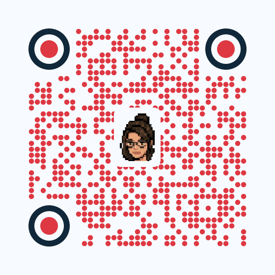
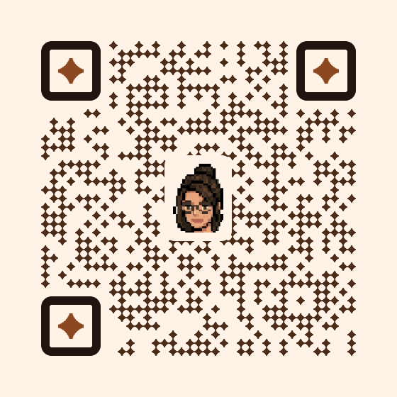
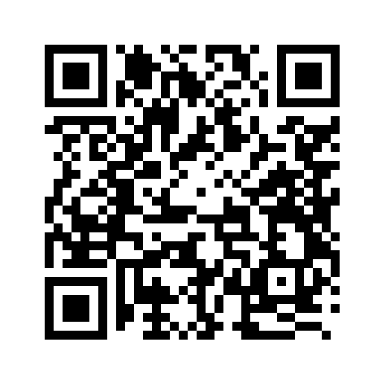
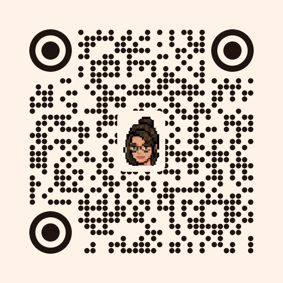
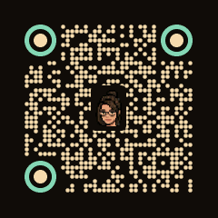
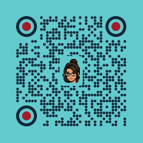

# styled-qr-c

Artistic QR codes in C99, with no dependencies and no allocation. Shaped
modules, styled finder patterns, gradients, and a logo in the middle paid for by
the error correction level — rendered straight into an RGB565 framebuffer.

| | | | |
|---|---|---|---|
|  |  |  |  |
|  |  |  |  |

Every code in this README has been read back by a scanner-side check before it
was committed: binarised, its finder patterns located by their 1:1:3:1:1 run,
and every module centre compared against the matrix. See
[Checking it](#checking-it).

## What this is, and what it is not

Two halves, and the line between them is the whole design.
[`src/qrcodegen.c`](src/qrcodegen.c) decides **which modules are dark** — the
encoding, the masking, the Reed-Solomon. [`src/qrstyle.c`](src/qrstyle.c)
decides **what a dark module looks like**, and it only ever reads that matrix.

Nothing in the styling layer can change which modules are dark. That is what
makes the whole thing tractable: a style that will not scan is a rendering bug
in one file, never a question about the standard.

The one thing that constrains every shape: a decoder samples the **centre** of
each module, and finds the code at all by the dark/light run through the middle
of a finder pattern. Everything below is shaped around those two facts.

- No heap. The caller owns every buffer.
- No static state. Nothing is kept between calls.
- No floating point in the renderer. One module is 256 units.
- 11.7 KB of flash on an ESP32-S3, with `.data` and `.bss` both at zero.

## Quick start

```c
#include "qrstyle.h"

uint8_t qr[qrcodegen_BUFFER_LEN_FOR_VERSION(10)];
uint8_t tmp[qrcodegen_BUFFER_LEN_FOR_VERSION(10)];

struct QrStyle_Config cfg;
QrStyle_ConfigPreset(&cfg, QRSTYLE_PRESET_LIQUID);
cfg.logo = &MY_LOGO;                 /* forces ECC HIGH to pay for the hole */

struct QrStyle_Target target = {
    .pixels = framebuffer, .width = 240, .height = 240, .stride = 240,
    .big_endian = true,              /* what an ST7789 wants */
};
struct QrStyle_Box box = { 0, 0, 240 };

if (QrStyle_EncodeText(url, &cfg, tmp, qr, 10, NULL) &&
    QrStyle_Check(qr, &cfg, NULL))
    QrStyle_Render(qr, &cfg, &target, &box);
```

Two translation units and one include directory:

```
src/qrcodegen.c
src/qrstyle.c
```

**ESP-IDF.** Point `EXTRA_COMPONENT_DIRS` at [`esp-idf/`](esp-idf), or copy
[`esp-idf/qrstyle`](esp-idf/qrstyle) into your project's `components/`.

**Host.** `make` builds the preview tool; `.\build.ps1` does the same on
Windows.

## The knobs

### 1. Modules

`module_shape`, plus `module_size_pct` for how much of its cell each one fills.

`SQUARE` · `ROUNDED` · `CIRCLE` · `DIAMOND` · `STAR` · `CROSS` · `LIQUID`

`LIQUID` is the one worth understanding. A module fills its whole cell, and a
corner is rounded only where *both* neighbours meeting at it are light. Runs of
dark modules fuse into one continuous form, a lone module comes out as a circle,
and — because every dark module keeps its entire cell — the most decorative
style in the list is also the one with the most margin. It is not a compromise;
it is free.

Every shape is centred on its module. `module_size_pct` clamps at 55: below
that, a phone camera's blur closes the gaps between modules faster than it
resolves the modules themselves.

### 2. Eyes

The three finder patterns, as an outer 7×7 frame and a 3×3 pupil, each styled
and each coloured independently of the data.

- `eye_frame`: `SQUARE` · `ROUNDED` · `CIRCLE` · `TEARDROP` · `LEAF`
- `eye_pupil`: `SQUARE` · `ROUNDED` · `CIRCLE` · `DIAMOND` · `STAR`
- `eyes_use_fg = false` to give them `eye_frame_fill` and `eye_pupil_fill`

`TEARDROP` and `LEAF` are oriented per eye: the sharp corner points *away* from
the middle of the symbol, so the three mirror into a set instead of being three
copies of one rotation.

All five frames are built from the same rounded-rectangle primitive with a
per-corner radius — a circle is one with a radius of half its width, a teardrop
is one with three corners rounded — and all of them keep the 1:1:3:1:1 run
intact along the centre row and column.

A circular eye does leave the corners of the 7×7 light where the matrix has them
dark. That is the point, not a defect: a finder pattern is *located* by its run
ratio, never read module by module. The checker counts those as `eye` and does
not fail them.

### 3. Colours and gradients

`fg`, `bg`, `eye_frame_fill`, `eye_pupil_fill` — each `SOLID`, `LINEAR` at any
angle, or `RADIAL`. A gradient is evaluated over the code's own bounding box, so
the ramp crosses the whole symbol rather than each module carrying a private
copy of it.

`bg_transparent` draws no background and blends onto whatever is already in the
target.

Two rules, and `QrStyle_Check()` measures both rather than trusting the design:

**Contrast.** The WCAG ratio between the worst foreground shade and the
background. Under 3.0, a phone camera in ordinary light starts losing the
threshold between a dark and a light module.

**One threshold, not many.** A decoder does not compare each module against the
background. It picks *one* threshold for the whole image, near the midpoint of
the two populations it can see — the data modules and the paper — and applies it
everywhere. A colour with fine contrast against the background but on the far
side of that midpoint binarises to *paper*. See
[what the checker caught](#what-the-checker-caught); it is not hypothetical, and
it is what decided several of the colours below.

### 4. Logo

An RGB565 image plus an optional 1bpp alpha mask, both `const` so they live in
flash. [`tools/logo-to-c.py`](tools/logo-to-c.py) converts an image; for pixel
art it resamples the sprite at its own grid rather than carrying somebody's 20×
upscale into your firmware.

The modules underneath are **not drawn at all**. A half-covered module is one a
decoder reads as the wrong colour; an absent one is an *erasure*, and
Reed-Solomon exists to repair erasures.

`size_pct` is the logo box's width as a percentage of the code's width, and it
has to stay under `QrStyle_LogoBudgetPct()`:

| Level | Restores | Budget |
|---|---|---|
| `LOW` | 7% | **0** |
| `MEDIUM` | 15% | 22% |
| `QUARTILE` | 25% | 26% |
| `HIGH` | 30% | 30% |

Half the level's restorable share, spent on *area*, expressed as a width, capped
at 30. Both the halving and the cap are the difference between the standard's
arithmetic and a scanner's day: a patch in the middle of a symbol destroys
codewords in a burst that interleaving only partly spreads across blocks, so one
contiguous hole is not the same bet as scattered damage. The cap also keeps the
timing patterns and the centre alignment pattern clear, and no amount of error
correction replaces those — they are how a decoder builds the grid it then reads
the codewords out of.

`pad_modules` counts against the budget too. An erased module is erased whether
a picture or the background colour replaced it.

### 5. Error correction

`QrStyle_EncodeText()` picks it: `HIGH` when the config carries a logo,
otherwise `MEDIUM` with qrcodegen's boost, which raises the level for free
whenever a higher one fits the version already chosen — so it never costs a
module. (The control example below comes out at Q rather than M for exactly that
reason: this repository's URL is a few characters longer than it needs to be for
version 4, and the boost spends the slack on error correction.)

`QrStyle_Ecl()` reads the level back out of an encoded symbol's format bits, so
`QrStyle_Check()` reasons about the code in front of it rather than about what a
caller says it asked for.

## Rendering

**Modules snap to whole pixels.** The renderer picks an integer
pixels-per-module and centres the result in the caller's box rather than scaling
to fill it. A fractional module size makes some modules a pixel wider than their
neighbours, and a decoder's grid estimate then walks off the true centres across
the width of the symbol — which shows up as a code that scans at one distance
and not another. A few pixels of unused box is the cheaper mistake. `box.size`
includes the quiet zone; `QrStyle_PixelsPerModule()` reports what the box bought.

**It renders into strips.** `origin_x`/`origin_y` are the logical coordinates of
`pixels[0]`, so a 240×240 frame drawn as two 240×120 strips — which is what a
part without room for a whole framebuffer does — passes the same box twice with
`origin_y` 0 and then 120. The last two examples are rendered exactly that way.

**Anti-aliasing is supersampled**, `supersample` samples per axis per pixel, 3 by
default. Shaped modules on a 240 px panel are 5 px across and unbearable without
it.

## The examples

All thirteen live in [`examples/preview.c`](examples/preview.c) and are
regenerated by `make examples`. The logo in every one is
[`assets/tori.png`](assets/tori.png), a 33×45 sprite:


It arrived as a 766×1024 JPEG with the transparency chequerboard flattened into
it. `tools/logo-to-c.py` measured the pixel-art grid from the image's own edge
energy (19.24 px), took one median sample per art pixel, keyed the chequerboard
out with a flood fill from the border — so a pale pixel *inside* the artwork
survives — and wrote [`examples/logo_tori.h`](examples/logo_tori.h). That is
3.2 KB of flash; the same image carried at its delivered 766×1024 would have
been 1.5 MB of RGB565 for no extra detail, with JPEG ringing around every hard
edge that a logo cut-out would then show off. Every example declares it the same way:

```c
static const struct QrStyle_Logo TORI = {
    .rgb565    = tori_logo_rgb565,
    .alpha_bits = tori_logo_alpha,
    .w = TORI_LOGO_W, .h = TORI_LOGO_H,
    .size_pct = 22,        /* 22 + a 1-module pad = 27 of the 30 HIGH affords */
    .pad_modules = 1,
    .pad_radius_pct = 30,
};
```

### Classic — the control



```c
QrStyle_ConfigPreset(cfg, QRSTYLE_PRESET_CLASSIC);
```

No style, no logo, black on white. It exists so the checker has something it
must agree with. It has already earned that: the checker's own binariser failed
this one and nothing else, which is how the bug was found. A checker that only
ever agrees with the thing it checks is decoration.

### Dots



```c
QrStyle_ConfigPreset(cfg, QRSTYLE_PRESET_DOTS);   /* CIRCLE at 88%, CIRCLE eyes */
cfg->fg = solid(INK);        /* 0x241610 */
cfg->bg = solid(PAPER);      /* 0xFAF3E7 */
cfg->logo = &TORI;
```

Circular modules at 88% of their cell with circular eyes. The plainest way to
stop looking like a barcode, and the palette is the sprite's own — the near-black
of its outline on the warm paper it wants to sit on. A logo that shares no colour
with the code around it reads as a sticker over a QR code rather than one object.

### Liquid


```c
QrStyle_ConfigPreset(cfg, QRSTYLE_PRESET_LIQUID);
cfg->fg = grad(INK_WARM, INK_COPPER, 55);   /* 0x4A2C18 -> 0x8A4B26, 55 deg */
cfg->eyes_use_fg = false;
cfg->eye_frame_fill = solid(INK);
cfg->eye_pupil_fill = solid(INK_COPPER);
cfg->bg = solid(PAPER);
cfg->logo = &TORI;
```

Neighbouring modules fuse and a lone one becomes a dot, under a linear gradient
running diagonally across the whole symbol. Full cell coverage, so this is the
safest style in the set as well as the loudest. It is also one of the four
examples with **zero** restyled finder modules: a rounded-square eye at this
radius still fills the corners of the 7×7, so it is not merely located
correctly, it *is* the matrix.

### Teardrop


```c
QrStyle_ConfigPreset(cfg, QRSTYLE_PRESET_TEARDROP);  /* ROUNDED 92%, TEARDROP eyes */
cfg->fg = radial(PINE, PINE_LIGHT);     /* 0x1C4B3C at the centre -> 0x2F7A5C */
cfg->eyes_use_fg = false;
cfg->eye_frame_fill = solid(PINE);
cfg->eye_pupil_fill = solid(INK_COPPER);
cfg->bg = solid(PAPER_WARM);            /* 0xF3E4CE */
cfg->logo = &TORI;
```

Each eye's sharp corner points away from the middle, so the three mirror into a
set. The radial gradient puts the darkest green at the centre, behind the logo,
and lets it lift toward the corners.

### Diamond


```c
QrStyle_ConfigPreset(cfg, QRSTYLE_PRESET_DIAMOND);   /* DIAMOND modules, LEAF eyes */
cfg->fg = grad(PINE, INK, 90);          /* top to bottom */
cfg->eyes_use_fg = false;
cfg->eye_frame_fill = solid(PINE);
cfg->eye_pupil_fill = solid(PINE);
cfg->bg = solid(PAPER);
cfg->logo = &TORI;
```

Leaf eyes are the same rounded-rectangle primitive with two opposite corners
sharp, on the outward diagonal, and a diamond pupil inside. A diamond covers half
the area of the square it is inscribed in, which is fine — the centre is what
gets sampled.

### Star


```c
QrStyle_ConfigPreset(cfg, QRSTYLE_PRESET_STAR);
cfg->fg = solid(INK_WARM);
cfg->eyes_use_fg = false;
cfg->eye_frame_fill = solid(INK);
cfg->eye_pupil_fill = solid(INK_COPPER);
cfg->bg = solid(PAPER);
cfg->logo = &TORI;
```

The star is the superellipse `sqrt(|x|) + sqrt(|y|) <= k`, with `sqrt(256) = 16`
as the unit. `k = 16` is the true astroid and it is too thin twice over: its arms
taper to nothing, so a module a handful of pixels across keeps a visible centre
and no arms at all, and it covers barely a third of what a circle would — which
is coverage a camera's blur eats first. `QRSTYLE_STAR_K` is **20**, where it
still reads as a star and has area to spare. It remains the style that wants the
most pixels per module.

### Night


```c
QrStyle_ConfigPreset(cfg, QRSTYLE_PRESET_LIQUID);
cfg->fg = grad(CANDLE, 0xC9A15E, 45);   /* 0xF0D9AC -> 0xC9A15E */
cfg->eyes_use_fg = false;
cfg->eye_frame_fill = solid(CANDLE);
cfg->eye_pupil_fill = solid(0xE0B05A);
cfg->bg = solid(NIGHT);                 /* 0x140F0A */
cfg->logo = &TORI;
```

Light ink on a dark ground. Inverted codes are legal and every current phone
reads them; a decade-old dedicated scanner may not.

### On the panel



```c
QrStyle_ConfigPreset(cfg, QRSTYLE_PRESET_DOTS);
cfg->module_size_pct = 92;
cfg->fg = solid(CANDLE);
cfg->eyes_use_fg = false;
cfg->eye_frame_fill = solid(MINT);      /* 0x86D6B0 -- see below */
cfg->eye_pupil_fill = solid(CANDLE);
cfg->bg = solid(NIGHT);
cfg->logo = &TORI;
ex->panel = true;                       /* 240x240, RGB565 BE, two strips */
```

Not a gallery render: this is a real 240×240 RGB565 big-endian framebuffer,
drawn as two 240×120 strips through two `QrStyle_Target`s that are windows onto
the same logical frame. Five pixels per module is what a small panel actually
has. If `origin_y` were being ignored, the seam would land in the middle of the
code and the module check would find it.

The mint is the interesting part — see below.

### KC / Teal


```c
QrStyle_ConfigPreset(cfg, QRSTYLE_PRESET_LIQUID);
cfg->fg = solid(KC_NAVY);               /* 0x16283C */
cfg->eyes_use_fg = false;
cfg->eye_frame_fill = solid(KC_NAVY);
cfg->eye_pupil_fill = solid(KC_RED_DEEP);   /* 0xA11F2A */
cfg->bg = solid(KC_TEAL);               /* 0x62C9C8 */
cfg->logo = &TORI;
```

Kansas City Current: teal ground, navy shield, red band. The club's own pairing,
fused, with a deep red pupil in each eye.

The pupil is `KC_RED_DEEP` and not the crest's bright red, and that is not a
taste decision. Bright KC red has a grey value of 106; the midpoint between navy
ink (36) and a teal ground (170) is 103. A bright red eye on this ground lands
within three points of the threshold a decoder picks and binarises to
*background*. Carrying the same hue down to `0xA11F2A` puts it at 71, clear of
the threshold with margin, and `QrStyle_Check()` refuses the bright one.

### KC / Crest


```c
QrStyle_ConfigPreset(cfg, QRSTYLE_PRESET_TEARDROP);
cfg->module_shape = QRSTYLE_MODULE_ROUNDED;
cfg->module_size_pct = 92;
cfg->fg = grad(KC_NAVY, KC_TEAL_DEEP, 55);  /* 0x16283C -> 0x17615E */
cfg->eyes_use_fg = false;
cfg->eye_frame_fill = solid(KC_NAVY);
cfg->eye_pupil_fill = solid(KC_RED);        /* 0xD93A44 -- bright, and fine here */
cfg->bg = solid(KC_WHITE);                  /* 0xF4F8F8 */
cfg->logo = &TORI;
```

Navy running into teal across the symbol, the way the crest's swoosh does, under
teardrop eyes.

The teal here is `KC_TEAL_DEEP`, because the bright teal cannot be **ink on
white** — 1.8:1 against this ground, well under the 3.0 the contrast check
demands. It is a ground colour, not an ink colour, which is why it is the
background in *KC / Teal* and darkened here. The bright red, meanwhile, needs no
help against white: the threshold sits at 176 and red is at 106.

### KC / Match Red


```c
QrStyle_ConfigPreset(cfg, QRSTYLE_PRESET_DOTS);
cfg->fg = solid(KC_RED);                /* 0xD93A44 */
cfg->eyes_use_fg = false;
cfg->eye_frame_fill = solid(KC_NAVY);
cfg->eye_pupil_fill = solid(KC_RED);
cfg->bg = solid(KC_WHITE);
cfg->logo = &TORI;
```

Red is the ink here, so it gets to be the bright one. Navy rings hold the eyes,
which also keeps the finder patterns the highest-contrast thing in the frame —
the part a decoder has to find first.

### KC / Midnight


```c
QrStyle_ConfigPreset(cfg, QRSTYLE_PRESET_LIQUID);
cfg->fg = solid(KC_TEAL);
cfg->eyes_use_fg = false;
cfg->eye_frame_fill = solid(KC_WHITE);
cfg->eye_pupil_fill = solid(KC_TEAL);
cfg->bg = solid(KC_NAVY);
cfg->logo = &TORI;
```

Teal on navy, white eyes. Red cannot be the accent on this one at all: with teal
ink (170) on navy (36) the threshold is 103, and red at 106 sits three points
above it — technically on the ink side, nowhere near the 10% margin, and visually
indistinguishable from the ground once binarised. White takes the job instead,
and it makes the eyes the strongest mark on the code.

### KC / On the panel



```c
QrStyle_ConfigPreset(cfg, QRSTYLE_PRESET_DOTS);
cfg->module_size_pct = 92;
cfg->fg = solid(KC_NAVY);
cfg->eye_frame_fill = solid(KC_NAVY);
cfg->eye_pupil_fill = solid(KC_RED_DEEP);
cfg->bg = solid(KC_TEAL);
cfg->logo = &TORI;
ex->panel = true;
```

The teal scheme at the size a 240×240 panel actually gets: five pixels per
module, RGB565 big-endian, two strips.

## Checking it

```
$ make examples

example                             ver  ecc  px/m contrast  logo/bud finders  bad   eye
----------------------------------  ---  ---  ---- -------- --------- ------- ---- -----
Classic (control)                     4    Q    13     21.0    0/26       6/6    0     0 ok
Dots                                  5    H    12     15.9   27/30       6/6    0    48 ok
Liquid                                5    H    12      6.1   27/30       6/6    0     0 ok
Teardrop                              5    H    12      4.1   27/30       6/6    0    36 ok
Diamond                               5    H    12      9.0   27/30       6/6    0    36 ok
Star                                  5    H    12      6.1   27/30       6/6    0    12 ok
Night                                 5    H    12      7.9   27/30       6/6    0     0 ok
On the panel (240x240, two strips)    5    H     5     11.1   27/30       6/6    0    48 ok
KC / Teal                             5    H    12      3.9   27/30       6/6    0     0 ok
KC / Crest                            5    H    12      4.2   27/30       6/6    0    36 ok
KC / Match Red                        5    H    12      4.2   27/30       6/6    0    48 ok
KC / Midnight                         5    H    12      7.6   27/30       6/6    0     0 ok
KC / On the panel                     5    H     5      3.9   27/30       6/6    0    48 ok

0 example(s) failed
```

| Column | |
|---|---|
| `finders` | 1:1:3:1:1 crosses found, of 6 — three eyes, scanned across and down |
| `bad` | module centres that read back as the wrong colour. **Must be 0** |
| `eye` | module centres a styled eye deliberately redrew. Counted, not failed |
| `contrast` | WCAG ratio, worst ink shade against the background |
| `logo/bud` | logo width used, against what the error correction level affords |

`examples/preview.c` renders each example and then tries to read it back the way
a decoder would: Otsu binarisation over the module centres, polarity taken from
the quiet zone so inverted codes are handled, finder crosses scored the way
ZXing's `FinderPatternFinder` scores them, and every module centre compared
against the matrix qrcodegen produced. `-v` prints the run lengths for any cross
that fails.

It is **not a decoder**. No perspective, no Reed-Solomon, and it already knows
where the code is. A pass is therefore not a promise that a particular phone in
particular light will read it. A failure is proof that the style broke the
symbol, which is the thing worth catching.

## What the checker caught

**A mint eye that stopped existing.** The dark example first used a mid green for
the finder frames against a near-black background. Fine contrast, pretty, and
*none of the three finder patterns could be found* — the green sat on the far
side of the one threshold a decoder picks, binarised to paper, and the rings
simply were not there. `QRSTYLE_INK_MARGIN_PCT` now refuses that pairing, and it
is what decided the colours in three of the four KC examples.

**An off-by-one in the checker itself.** Otsu's method splits a histogram into
`[0..t]` and `[t+1..255]`, so the threshold bin belongs to the low class.
Comparing with `<` instead of `<=` put every pixel of a two-tone image on the
same side. It failed the plain black-on-white control and nothing else, which is
exactly what a control is for.

## Footprint

`xtensa-esp32s3-elf-gcc 14.2.0`, `-Os -DNDEBUG`, clean at `-Wall -Wextra
-Wpedantic`:

| | text | data | bss |
|---|---|---|---|
| `qrstyle.c` | 6.1 KB | 0 | 0 |
| `qrcodegen.c` | 5.6 KB | 0 | 0 |

Plus the caller's two encode buffers — `qrcodegen_BUFFER_LEN_FOR_VERSION(n)`
bytes each, 408 at version 10, 3918 at version 40 — and whatever the logo weighs.
Cap `max_version` at what the payload needs; version 40 is 7.8 KB of RAM for a
symbol nothing here is asking for.

## Layout

```
src/qrcodegen.{c,h}   encoding: which modules are dark
src/qrstyle.{c,h}     rendering: what a dark module looks like
examples/preview.c    renders the examples, then reads them back
examples/logo_tori.h  the sprite, generated
tools/logo-to-c.py    image -> C header (needs Pillow; not part of any build)
esp-idf/qrstyle/      an ESP-IDF component wrapping both units
assets/               the sprite and the rendered examples
```

## Licensing

There is no repository licence, so this code is under default copyright.

`src/qrcodegen.c` and `src/qrcodegen.h` are the exception. They are Project
Nayuki's QR Code generator under the MIT licence, and the licence text sits at
the top of both files. It has to stay there — MIT's one condition is that the
notice travels with the code — and it covers those two files only.

The Kansas City Current colours in the examples are used to demonstrate a
palette; no affiliation, and no club mark is reproduced here.
